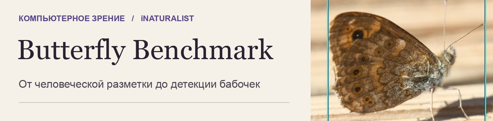
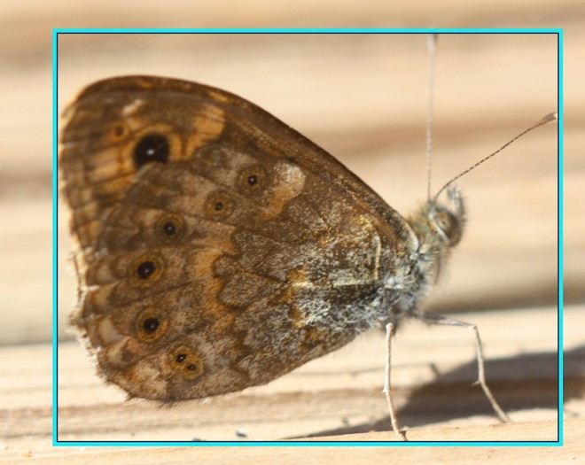
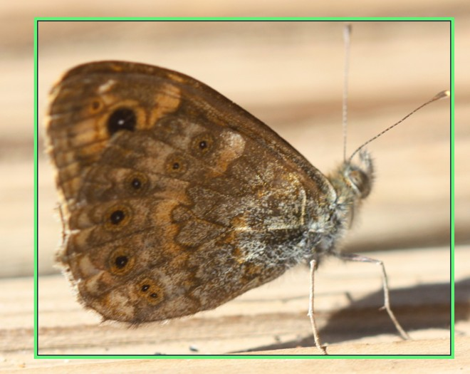

# Butterfly Benchmark

**Сможет ли модель обвести каждую бабочку на фотографии и оставить кадр пустым, если в нём только пчела или цветок?** Мы собрали эталон на снимках iNaturalist, сравнили три локальные модели и проверили, когда второй детектор помогает первой модели.

[Результаты](#результаты) · [Пример на фото](#как-подтверждается-рамка) · [Воспроизведение](#воспроизведение) · [Фотографии](https://github.com/Fu22210/butterfly-benchmark/releases/tag/v1.0.0) · [Презентация проекта](presentation/final_project.pptx)

| Командный набор | Эталон | Лучшая стратегия | Object F1@0,5 |
|:---|:---|:---|:---|
| 400 фотографий CC0 | 193 бабочки, 209 пустых кадров | Qwen + подтверждение OWLv2 | **0,9337** |

## Как подтверждается рамка

Qwen предлагает рамки всех взрослых бабочек. OWLv2 независимо обрабатывает тот же кадр. Мы оставляем рамку Qwen, если у OWLv2 есть рамка с уверенностью **≥ 0,40** и пересечением с предложением Qwen **IoU ≥ 0,30**. Каждое подтверждение можно использовать один раз. В ответ попадают координаты Qwen. Если подтверждений нет, результатом будет пустой список.

| 1 · Две модели нашли объект | 2 · Рамка, попавшая в ответ | 3 · Человеческий эталон |
|:---:|:---:|:---:|
|  |  |  |
| Уверенность OWLv2 **0,446** | IoU двух моделей **0,679** | IoU ответа с эталоном **0,958** |

На фото **530805** детекторы немного расходятся по краям крыльев. Их согласия хватает, чтобы сохранить рамку Qwen. С человеческим эталоном эту рамку сравниваем уже при оценке. [Оригинал снимка](https://www.inaturalist.org/photos/530805) · [Код подтверждения](model_comparison/strategy.py)

## Результаты

Все строки посчитаны на одних и тех же 400 фотографиях. В столбцах TP, FP и FN указано число найденных бабочек, лишних рамок и пропущенных бабочек при IoU с эталоном ≥ 0,5.

| Модель или стратегия | F1@0,5 | F1@0,75 | TP | FP | FN |
|:---|---:|---:|---:|---:|---:|
| Grounding DINO tiny · порог 0,30 | 0,5925 | 0,5392 | 189 | 256 | 4 |
| OWLv2 base · порог 0,10 | 0,3453 | 0,2105 | 187 | 703 | 6 |
| Qwen3-VL-2B-Instruct | 0,7249 | 0,6565 | 191 | 143 | 2 |
| Grounding DINO tiny · порог 0,40 | 0,6757 | 0,6252 | 174 | 148 | 19 |
| OWLv2 base · порог 0,40 | 0,8878 | 0,5486 | 178 | 30 | 15 |
| Qwen + подтверждение DINO | 0,7762 | 0,7105 | 189 | 105 | 4 |
| OWLv2 предлагает, Qwen редактирует | 0,9316 | 0,8152 | 184 | 18 | 9 |
| **Qwen + подтверждение OWLv2** | **0,9337** | **0,8520** | **183** | **16** | **10** |

У исходного Qwen все 143 ложные рамки пришлись на пустые кадры. Подтверждение OWLv2 убрало **127 ложных рамок** ценой **8 верных обнаружений**. При обратном порядке моделей редактор нашёл ещё одну бабочку, но оставил две дополнительные ложные рамки. Разбор такого дубля на фото 1768128 есть в отчёте. [Эксперимент с редактором и примеры](model_comparison/owl_qwen_editor/report.md)

**Как читать результат.** Оценщик находит максимальное число пар «предсказание — эталон» с IoU не ниже заданного порога. Каждая рамка входит максимум в одну пару. После суммирования по кадрам получаем F1 = 2 × TP / (2 × TP + FP + FN). Пороги подобраны на командном наборе, все пять разбиений выбрали одно правило. Качество на скрытом эталоне Контеста неизвестно. [Все 43 конфигурации и результаты по разбиениям](model_comparison/strategy_results/evaluation.json) · [Метрики по группам](model_comparison/predictions/metrics.json)

## Данные и разметка

В основном наборе 191 кадр с бабочками и 209 пустых. Помимо взрослых бабочек в выборку вошли жуки, перепончатокрылые, гусеницы и растения. Категория наблюдения помогает анализировать ошибки. Наличие объекта определяется по рамкам. Для каждой фотографии сохранены источник, сведения об авторстве, лицензия и SHA-256. [Состав выборки](butterfly_dataset/README.md) · [Манифест 400 фото](butterfly_dataset/main/metadata.jsonl)

Разметчик обводит видимые части каждой бабочки. Ревьюер проверяет пропуски, лишние рамки и границы. Сохранены 400 принятых записей. Пять спорных снимков дополнительно пересмотрены с помощью модели, в одном случае рамка изменена. Происхождение этого решения указано в журнале. [Материалы для разметчиков](butterfly_bbox/README.md) · [Решения ревью и исправления](annotation_review/README.md) · [Итоговый эталон](model_comparison/gold.jsonl)

## Воспроизведение

**Пересчитать лидерборд без GPU.** Для этих команд достаточно Python 3.10+ и сохранённых предсказаний из репозитория.

```bash
git clone https://github.com/Fu22210/butterfly-benchmark.git
cd butterfly-benchmark/model_comparison
python3 evaluate.py gold.jsonl predictions --metadata ../butterfly_dataset/main/metadata.jsonl
python3 strategy.py tune gold.jsonl predictions /tmp/butterfly-strategies
```

**Собрать и проверить посылку** из сохранённых выходов Qwen и OWLv2. Из того же каталога выполните команды ниже.

```bash
python3 strategy.py apply strategy_results/config.json contest/predictions /tmp/butterfly-answer.jsonl
python3 contest/validate_submission.py contest/dataset.jsonl contest/submission-template.jsonl /tmp/butterfly-answer.jsonl
```

**Запустить сами модели.** Распакуйте `team-media.zip` в корень клона. Исходные прогоны выполнены на NVIDIA A100 80 GB. Версии весов и промпты зафиксированы в коде. [Скачать фотографии и превью](https://github.com/Fu22210/butterfly-benchmark/releases/download/v1.0.0/team-media.zip) · [Установка и команды инференса](model_comparison/README.md) · [Настройки победителя](model_comparison/strategy_results/config.json)

## Материалы проекта

| Раздел | Что внутри |
|:---|:---|
| [Данные iNaturalist](butterfly_dataset/) | Манифесты основной и резервной выборок, проверка лицензий, галерея |
| [Интерфейс разметки](butterfly_bbox/yandex/) | HTML, CSS и JavaScript, конфигурации проектов, тренировочные и рабочие задания |
| [Ревью](annotation_review/) | Принятые ответы, обезличенные связи между участниками и журнал пересмотра |
| [Модели и эксперименты](model_comparison/) | Инференс, метрики, подбор порогов, исходные ответы и отчёты |
| [Контест](model_comparison/contest/) | Экзаменационный манифест, шаблон, автоматическая посылка и валидатор |
| [Ранний пилот](pilot/) | Сборщик iNaturalist, правила отбора и манифесты отдельной пробы на 500 фото |
| [Презентация](presentation/final_project.pptx) | Исходные слайды с защитой проекта и визуальными примерами |
