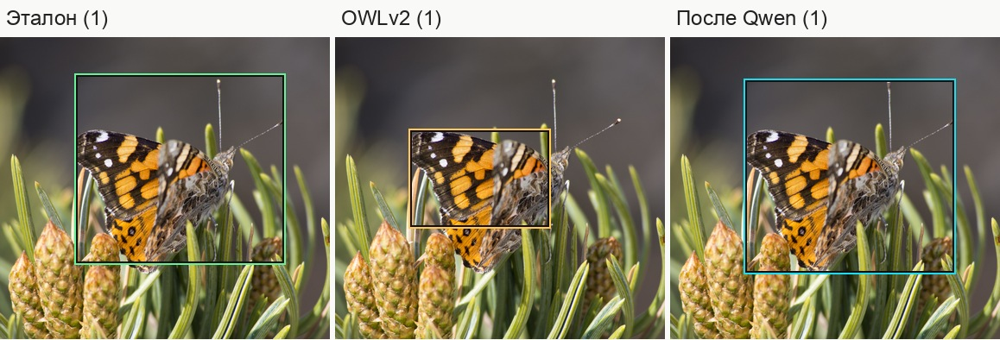
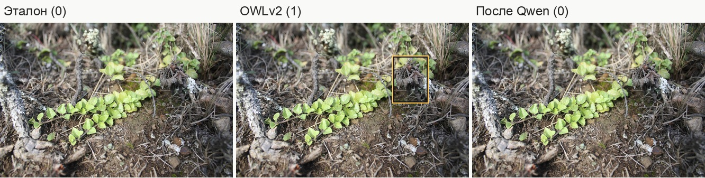
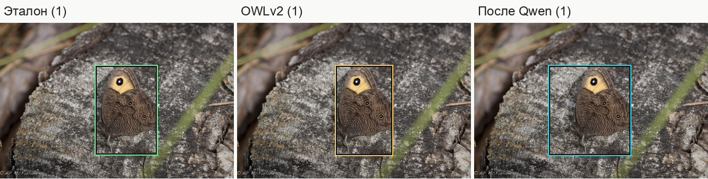
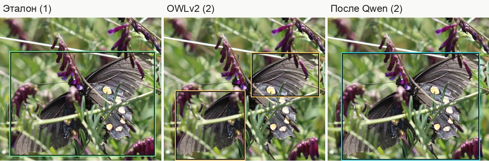
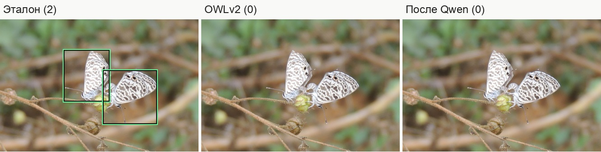

# Что меняется, когда Qwen редактирует рамки OWLv2

**На 400 фотографиях команды редактор улучшил OWLv2 с 0,8878 до 0,9316 по object F1@IoU 0,5.** Особенно заметно улучшились границы объектов: при строгом IoU 0,75 F1 вырос с 0,5486 до 0,8152. Лучшим по основной метрике остаётся прежний ансамбль «Qwen предлагает, OWLv2 подтверждает» с F1 0,9337. Новый вариант нашёл на одну бабочку больше и выдал на две лишние рамки больше. Разница в F1 всего 0,0020 на этом наборе.

## Как поставлен эксперимент

OWLv2 base обработал все оригиналы с прежними настройками. Из сохранённых детекций после NMS взяли рамки со score ≥ 0,40. Получилось 208 рамок на 205 кадрах. На 195 кадрах кандидатов не оказалось, итог для них сразу пустой. Восемь из 193 эталонных бабочек находятся именно на этих 195 кадрах.

Для **каждой** рамки Qwen3-VL-2B-Instruct получил исходную фотографию целиком и четыре числа OWLv2 в тексте запроса, в шкале 0–1000 относительно оригинала. Задача — проверить объект по указанным координатам, вернуть плотную рамку вокруг видимых частей взрослой бабочки или отклонить предложение ответом `[]`. Добавление других объектов инструкция исключает. Если на фото было два кандидата, выполнялись два отдельных вызова. Дополнительное удаление дублей после редактора в этом эксперименте отключено. Человеческие рамки использовались только при локальном подсчёте метрик.

Инференс выполнен на NVIDIA A100 PCIe 80 ГБ № 2 в Brain Lab. Версия Qwen, BF16, полноразмерный вход с применением EXIF-ориентации, параметры процессора и жадная генерация совпадают с базовым запуском Qwen. Промпт редактора и его входные координаты — основное изменение. Один ответ вернулся как массив четырёх чисел вместо объекта с ключом `bbox_2d`. Парсер принял этот эквивалентный формат после автоматического повтора. Во всех 400 итоговых строках результат заполнен. [Промпт и код прогона](run.py) · [Исходные предложения и сырые ответы](results/journal.jsonl)

## Результат и вклад каждой операции

TP, FP, FN, precision и recall в таблице относятся к IoU 0,5. Сопоставление выполнялось отдельно на каждом фото с максимальным числом допустимых пар. Строки про отбраковку и геометрию пересчитаны по тем же решениям Qwen, поэтому вклад этих действий можно оценить без изменения промпта или выборки.

| Конфигурация | TP / FP / FN | Precision | Recall | F1@0,5 | F1@0,75 | FP на пустых |
|---|---:|---:|---:|---:|---:|---:|
| OWLv2 без редактора | 178 / 30 / 15 | 0,8558 | 0,9223 | 0,8878 | 0,5486 | 21 |
| Только отбраковка Qwen, координаты OWLv2 | 178 / 24 / 15 | 0,8812 | 0,9223 | 0,9013 | 0,5570 | 15 |
| Только правка геометрии, при отклонении сохраняется исходная рамка | 184 / 24 / 9 | 0,8846 | 0,9534 | 0,9177 | 0,8030 | 21 |
| **OWLv2 → Qwen, правка и отбраковка** | **184 / 18 / 9** | **0,9109** | **0,9534** | **0,9316** | **0,8152** | **15** |
| Прежний ансамбль для сравнения | 183 / 16 / 10 | 0,9196 | 0,9482 | **0,9337** | **0,8520** | 16 |

- **Отбраковка.** Qwen отклонил 6 из 208 предложений. Все 6 относились к пустым по эталону кадрам. После редактирования осталось 202 рамки на 199 фото.
- **Геометрия.** У 149 из 202 принятых рамок изменилась хотя бы одна координата в шкале 0–1000. Если сравнивать одни и те же принятые предложения, правка дала шесть дополнительных совпадений при IoU 0,5 и ни одного потерянного. При IoU 0,75 на уровне кадров прибавилось 52 совпадения и потерялось одно, в сумме 110 → 161.
- **Время.** На новом этапе редактора суммарное время обработки кадров, включая повтор, составило 604 с. Историческое время первого этапа OWLv2 — 468 с. Вместе около 17 мин 52 с без загрузки весов. Новый запуск использовал сохранённые выходы OWLv2. [Полные метрики](results/metrics.json)

## Пять примеров из прогона

В каждой иллюстрации **слева** человеческий эталон (зелёная рамка), **в центре** исходное предложение OWLv2 (жёлтая), **справа** итог после Qwen (голубая). В скобках указано число рамок. Примеры подобраны для разбора механизмов ошибок. Общие метрики рассчитаны по всем 400 кадрам.

### 1. Редактор восстановил границы бабочки — фото 1759775



OWLv2 обвёл центральную часть бабочки: кончики усиков и часть крыла выходят за жёлтую границу. Qwen расширил рамку. **IoU с эталоном вырос с 0,348 до 0,918**. Для основной метрики один FP и один FN превратились в один TP.

### 2. Редактор правильно отклонил предложение — фото 19370



На кадре с растением OWLv2 отметил участок справа. В эталоне бабочек нет. Получив предложенную рамку и оригинал, Qwen вернул `[]`. Для этого кадра **FP уменьшилось с 1 до 0**. Правильный пустой ответ не добавляет TP.

### 3. Хорошая рамка стала хуже — фото 1000158



Qwen расширил рамку влево и включил больше поверхности камня. **IoU упал с 0,916 до 0,741**. При основном пороге 0,5 это по-прежнему TP. При 0,75 совпадение потеряно. Это единственный кадр, на котором редактирование принятых предложений уменьшило число TP при строгом пороге.

### 4. Две отдельные правки дали дубль — фото 1768128



В эталоне одна бабочка. Две исходные рамки OWLv2 покрывали разные её части, с IoU **0,198** и **0,297** относительно эталона. Qwen независимо расширил обе до почти одинаковой рамки вокруг всей бабочки; их IoU с эталоном стали **0,907** и **0,906**. На правой панели две голубые линии практически накладываются. Оценщик засчитал **1 TP и 1 FP**. Это конкретный случай для будущей проверки удаления дублей после редактирования.

### 5. Две бабочки остались без предложения — фото 710288



Лучший score OWLv2 равен 0,3964 при пороге 0,40. На вход редактора не поступило ни одной рамки. Итог — **два FN**. Более точное редактирование координат само по себе этот тип пропуска исправить не может.

## Решение

Если нужен **редактор черновой разметки OWLv2**, эксперимент подтверждает пользу такого подхода на командном наборе. Основной выигрыш даёт уточнение геометрии. Если выбирать лучшую из всех испытанных конфигураций по метрике Контеста, прежний ансамбль сохраняет первое место. Закрытые экзаменационные кадры в сравнении не участвовали.

### Воспроизведение

Из каталога `model_comparison`, при наличии журналов исходного запуска OWLv2, исходных снимков и окружения из README:

```sh
python owl_qwen_editor/run.py ../butterfly_dataset/main/images predictions/owl.journal.jsonl owl_qwen_editor/results
python owl_qwen_editor/evaluate_edit.py . owl_qwen_editor/results
```

Для нового прогона используют отдельный каталог результатов. Прежний каталог позволяет продолжить расчёт после технической ошибки. [Итоговый JSONL на 400 снимков](results/predictions.jsonl) · [Код оценки](evaluate_edit.py) · [Ревизии весов и окружение](../README.md)
